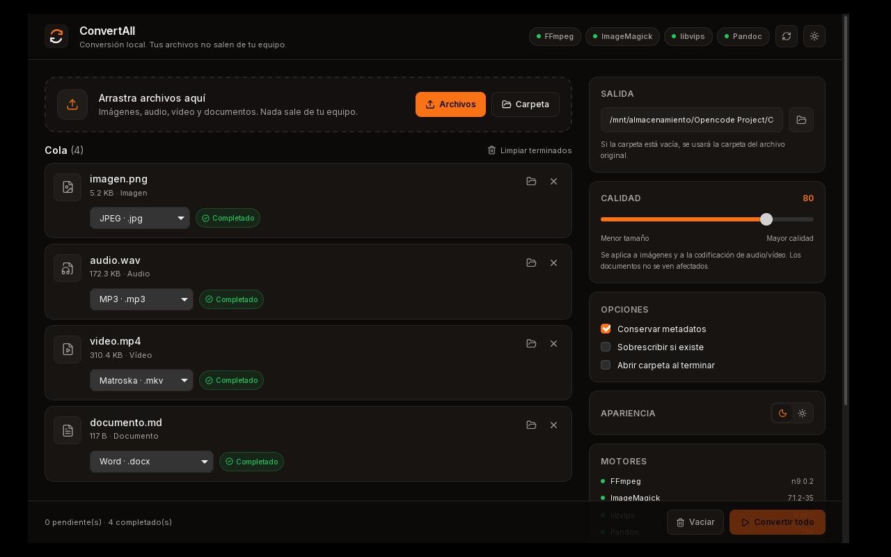

# ConvertAll

Conversor de archivos **local** para Linux y Windows. Sin subidas, sin cuentas y sin telemetría.

Usa motores nativos en lugar de WebAssembly:

- **FFmpeg** para audio y vídeo.
- **ImageMagick** y **libvips** para imágenes.
- **Pandoc** para documentos.

La interfaz está construida con **Tauri 2 + Svelte 5 + Tailwind CSS 4** y el backend con **Rust**.



## Estado

Proyecto en fase **M1**: shell funcional, detección de motores, cola de archivos, selección de formato, progreso, cancelación y conversión local.

Verificado en Linux y Windows:

- `svelte-check` sin errores, build de Vite y `cargo check` correctos.
- 14 pruebas Rust correctas.
- 77 conversiones reales correctas en Linux (imagen, audio, vídeo y documentos).
- 4 archivos convertidos desde la GUI y desde el AppImage (PNG→JPG, WAV→MP3, MP4→MKV, MD→DOCX).
- El AppImage aísla los motores de sus propias bibliotecas para que libvips e ImageMagick usen las del sistema.
- Paquete portable de Windows (`.zip`) con FFmpeg, Pandoc e ImageMagick incluidos.
- Motores de Windows probados bajo Wine: 13/13 conversiones correctas.
- La app arranca y detecta FFmpeg, ImageMagick, libvips y Pandoc.

Pendiente:

- Office/PDF de alta fidelidad con LibreOffice (fase 2).
- Presets, perfiles y más ajustes por formato.

## Descargas

A partir de **v0.1.2** se mantiene una sola release con la última versión: [Releases](https://github.com/Acd212/ConvertAll/releases/latest).

- Windows: `ConvertAll_x.y.z_x64-portable.zip`, sin instalador. Descomprime y ejecuta `ConvertAll.exe`.
- Linux: `ConvertAll_x.y.z_amd64.AppImage`.

Las versiones nuevas reemplazan los archivos de esa misma release; no se crea una entrada de release por versión. Ya no se publican MSI, NSIS ni DEB.

En Windows, el zip necesita WebView2. Windows 11 lo incluye y la mayoría de Windows 10 también; si falta, instálalo desde [Microsoft Edge WebView2](https://developer.microsoft.com/microsoft-edge/webview2/).

El AppImage incluye WebKit2GTK 4.1, GTK3 y libsoup, así que no requiere instalar WebKit en el sistema. Los motores (FFmpeg, ImageMagick, libvips y Pandoc) sí siguen siendo del sistema.

## Requisitos de desarrollo

- Rust estable (`rustc`, `cargo`).
- Bun (o Node 20+ y npm/pnpm).
- Linux: GTK3, WebKit2GTK 4.1, libsoup3, librsvg, patchelf.
- Motores: `ffmpeg`, `magick`, `vips` y, opcionalmente, `pandoc`.

En CachyOS/Arch:

```bash
sudo pacman -S --needed ffmpeg imagemagick libvips
# Pandoc no es obligatorio para compilar:
./scripts/fetch-pandoc-linux.sh
```

## Desarrollo

```bash
bun install
./scripts/dev.sh
```

`scripts/env.sh` redirige `CARGO_HOME`, `CARGO_TARGET_DIR`, la caché de Bun/npm y `TMPDIR` a `./cache/`.

También puedes abrir archivos directamente desde la terminal (o con «Abrir con…»):

```bash
convertall imagen.png audio.wav video.mp4 documento.md
```

## Comprobar

```bash
./scripts/check.sh
```

## Probar conversiones

Genera muestras con FFmpeg/ImageMagick y prueba todos los destinos del catálogo:

```bash
./scripts/test-conversions.sh
```

Los archivos de prueba se crean en `cache/tmp/samples/`.

## Compilar

```bash
./scripts/build.sh
```

Los paquetes locales se generan dentro de `cache/cargo-target/release/bundle/`. El CI de Windows crea el `.zip` portable en `cache/portable/`.

## Windows

El repositorio incluye `.github/workflows/build.yml`. En cada push a `main`:

1. Se descargan FFmpeg, Pandoc e ImageMagick portables.
2. Se compila la app en `windows-latest`.
3. Se empaqueta `ConvertAll.exe`, `tools/` y `licenses/` en un `.zip` portable.

El zip no se instala: se descomprime en cualquier carpeta y se ejecuta `ConvertAll.exe`. La carpeta `tools/` debe quedar junto al ejecutable.

Los binarios descargados no se versionan: `src-tauri/resources/windows/` está en `.gitignore`.

## Estructura

```text
src/                 Interfaz Svelte
src/lib/             Tipos, API y componentes
src-tauri/src/       Backend Rust
  formats.rs         Catálogo y reglas de conversión
  engines.rs         Detección de FFmpeg/ImageMagick/libvips/Pandoc
  capabilities.rs    Formatos/codecs reales de cada motor
  convert.rs         Ejecución, progreso y cancelación
  commands.rs        Comandos de Tauri
scripts/             Entorno, builds, pruebas y descarga de herramientas
assets/icon.svg      Fuente de los iconos
docs/captura.png     Captura de la interfaz
cache/               Caché y artefactos (ignorado por git)
```

## Licencia

MIT. ConvertAll es un proyecto original inspirado en la experiencia de VERT; no reutiliza su código (AGPL-3.0).

Los motores externos conservan sus propias licencias: FFmpeg (GPL/LGPL según build), ImageMagick, libvips (LGPL) y Pandoc (GPL-2.0+). Ver `THIRD_PARTY_LICENSES.md`.
